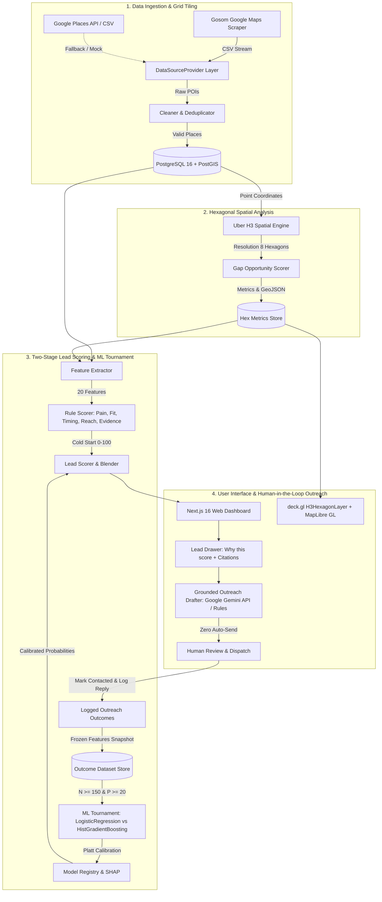

# GapScout

[](https://github.com/kamalnathmallick/GapScout/actions/workflows/ci.yml)
[](https://github.com/kamalnathmallick/GapScout/releases)
[](LICENSE)
[](https://www.python.org/)
[](https://postgis.net/)
[](https://h3geo.org/)
[](https://nextjs.org/)

**GapScout** is a map-based market intelligence and lead ranking platform for local businesses. It partitions city areas onto an **Uber H3 hexagonal spatial grid** to uncover where commercial categories are oversaturated or underserved, then ranks individual prospects using a **two-stage architecture**: transparent 5-factor cold-start rules that seamlessly blend into an **active-learning machine learning tournament** as real customer outreach outcomes (replies / conversions) are logged.

---

## Architecture



---

## Key Features

### 1. Hexagonal Spatial Market Intelligence (Uber H3 + deck.gl)
- **Multi-Resolution Hex Grid:** Partitions metropolitan areas into uniform H3 resolution-8 hexagons (~460m edge length / 0.74 km²).
- **Opportunity Scoring (0–100):** Calculates commercial balance based on competitor density, average ratings, review volume, and footfall anchor density.
- **GPU-Accelerated WebGL Visualization:** Real-time rendering via `@deck.gl/geo-layers` (`H3HexagonLayer`) and MapLibre GL vector tiles.
- **Explainable Hex Drawers:** Deep-dives into local supply-demand metrics, market labels (*underserved*, *balanced*, *oversaturated*), and POI directories.

### 2. Two-Stage Lead Scorer & Self-Improving ML Pipeline
- **Day-One Rule Cold Start:** Ranks prospects immediately with transparent 0–100 scoring across 5 dimensions:
  - **Pain (25%):** Low ratings, negative review themes, slow owner response rate.
  - **Fit (25%):** Alignment with workspace Offer Profile (categories, rating bands, target territories).
  - **Timing (15%):** Recent review inactivity, fresh listing updates.
  - **Reachability (20%):** Verified named emails, direct mobile/E.164 phones, active websites.
  - **Evidence (15%):** Depth of customer review data and digital footprint.
- **Cold-Start Gating:** Enforces $N \ge 150$ labelled outcomes and $P \ge 20$ positive replies before activating ML.
- **Challenger Tournament:** Evaluates baseline regularized Logistic Regression against HistGradientBoostingClassifier with Platt probability calibration.
- **Explainable Predictions:** Top-3 SHAP feature attributions on every lead drawer.
- **Active Learning Queue:** Automatically surfaces leads in the maximum uncertainty zone ($0.35 \le p \le 0.65$) to accelerate model convergence.

### 3. Human-in-the-Loop Grounded Outreach (Zero Auto-Send)
- **Zero Automated Dispatch:** The system has no auto-send mechanism. It generates drafts; humans review and send.
- **Strict Channel Length Caps:** WhatsApp / Chat $\le 450$ characters; Cold Email $\le 120$ words.
- **Factual Citations:** Claude 3.5 Sonnet / Haiku extracts factual review themes and website audit issues, strictly forbidding invented metrics.
- **Mandatory Opt-Out:** Every template includes a standard opt-out line.
- **Do-Not-Contact (DNC) Lock:** Enforces workspace-level phone, email, and root domain suppression lists.

### 4. Hardened Multi-Tenant Security & Compliance
- **Database-Level Multi-Tenancy:** Foreign key workspace scoping across all models with automated cross-tenant isolation tests.
- **Prompt Injection Defense:** XML boundary quarantine (`<untrusted_content>`) neutralizes malicious reviewer attacks.
- **SSRF Protection:** Web audit fetcher blocks loopback, private IPv4/IPv6, and cloud metadata endpoints (AWS/GCP).
- **GDPR / Privacy Compliance:** Full account JSON/CSV data export and irreversible cascade deletion; scheduled Celery Beat task prunes raw scraped data older than 90 days.
- **Google Maps TOS Fair-Use Notice:** Prominent notice and consent checkbox on job creation.

---

## Tech Stack

| Component | Technology | Description |
|---|---|---|
| **Backend API** | Python 3.11, FastAPI, Pydantic v2 | High-throughput asynchronous REST API |
| **Spatial Database** | PostgreSQL 16 + PostGIS, SQLAlchemy 2, Alembic | Spatial containment, GIST indexing, spatial joins |
| **Spatial Indexing** | Uber H3 (Python `h3` v4) | Hexagonal discrete global grid system |
| **Machine Learning** | scikit-learn, LightGBM, SHAP | Model tournament, Platt calibration, SHAP values |
| **Async Tasks** | Redis 7, Celery 5.7 (Worker & Beat) | Distributed scraping, grid tiling, retention pruning |
| **Frontend** | Next.js 16 (App Router), TypeScript, Tailwind CSS | Server-rendered React 19 web application |
| **Map Rendering** | deck.gl v9, MapLibre GL | WebGL hexagonal overlay and vector map layers |
| **Scraper Service** | `gosom/google-maps-scraper` | Containerized open-source scraper in Docker |
| **LLM Enrichment** | Google Gemini API (`google-genai`: Flash / Pro) | Grounded website audit & review theme extraction |
| **Quality & CI** | Pytest, Vitest, Playwright, Ruff, Mypy, ESLint | 350+ tests, scraper contract tests, CI pipelines |

---

## 5-Minute Quick Start

### 1. Prerequisites
- [Docker Desktop](https://www.docker.com/) installed and running.
- Python 3.11+ and Node.js 20+ (for running scripts or frontend outside containers).

### 2. Start the Full Stack
```bash
# Clone the repository
git clone https://github.com/kamalnathmallick/GapScout.git
cd GapScout

# Spin up all 7 Docker services
docker compose up -d
```

### 3. Run Migrations & Seed Bangalore Demo Data
```bash
# Apply Alembic database migrations
docker exec gapscout-api-1 alembic upgrade head

# Seed realistic Bangalore (Indiranagar & Koramangala) cafes and ML tournament
docker exec gapscout-api-1 python ../../scripts/seed_demo.py
```

### 4. Access the Platform
- **Web Application:** http://localhost:3000
  - **Login:** `demo@gapscout.test`
  - **Password:** `DemoPassword123!`
- **Interactive API Documentation:** http://localhost:8000/docs
- **Health Check:** http://localhost:8000/health

---

## 30-Second Agent Skills Install

GapScout includes pre-packaged **Agent Skills** compatible with Claude Code and AI Coding Agents.

Install the skills directly into your agent environment:
```bash
# Copy GapScout agent skills into your agent config
mkdir -p ~/.claude/skills
cp -r skills/* ~/.claude/skills/
```

Available skills:
- `/gapscout-setup`: Environment initialization, migrations, and demo data seeding.
- `/gap-scan`: Bounding box decomposition and H3 opportunity analysis.
- `/lead-rank`: Lead querying, sorting, and "Why this score" inspection.
- `/draft-pitch`: Compliant, grounded cold email and WhatsApp copy generation.
- `/log-outcome`: Real-world contact tracking and ML retraining triggers.

Validate skills structure anytime:
```bash
python scripts/validate_skills.py
```

---

## Architecture Decision Records (ADRs)

Key architectural trade-offs are documented in [`/docs/adr/`](docs/adr):
- [ADR 0001: H3 Hexagonal Spatial Indexing vs Rectangular Grid](docs/adr/0001-h3-spatial-indexing.md)
- [ADR 0002: Rules-First Scoring Blended with Calibrated Machine Learning](docs/adr/0002-rules-first-blended-ml.md)
- [ADR 0003: DataSourceProvider Abstraction Layer](docs/adr/0003-data-source-provider-abstraction.md)
- [ADR 0004: Workspace Multi-Tenancy and Isolation Hardening](docs/adr/0004-workspace-multi-tenancy-and-rls.md)
- [ADR 0005: Grounded Draft-Only Outreach and Zero Auto-Send](docs/adr/0005-grounded-draft-only-outreach.md)
- [ADR 0006: Untrusted Scraped Data Quarantine and Prompt Injection Defense](docs/adr/0006-prompt-injection-and-scraping-compliance.md)
- [ADR 0007: Dual Storage Architecture: PostGIS Spatial Engine & Redis/Celery](docs/adr/0007-dual-store-postgis-celery.md)

---

## Limitations

- **No Autonomous Messaging:** GapScout does not integrate with SMTP servers, Twilio, or WhatsApp Business APIs for automatic dispatch. Outreach requires human action.
- **Scraper Throughput Limits:** Headless scraping requires polite pacing (`SCRAPER_CONCURRENCY=2`) to avoid IP throttling.
- **Cold-Start Data Requirements:** Machine learning models require a minimum of 150 labelled outcomes and 20 positive replies before replacing rule scoring.

---

## Legal & Compliance Notice

> [!IMPORTANT]
> **Notice Regarding Google Maps Data & Terms of Service:**
> Scraping Google Maps may violate Google's Terms of Service. GapScout provides a pluggable `DataSourceProvider` interface designed to support official APIs (e.g., Google Places API New), CSV imports, or fair-use local intelligence. Users are solely responsible for ensuring compliance with applicable terms of service and local data protection regulations (GDPR, CAN-SPAM, CCPA).
>
> GapScout enforces field-level ingestion allow-lists, 90-day raw data retention limits, and automatic DNC suppression to uphold data privacy standards.

---

## License

This project is licensed under the [MIT License](LICENSE).
